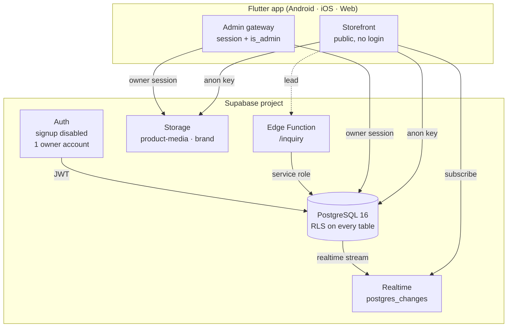
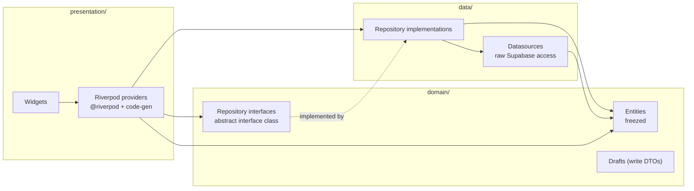
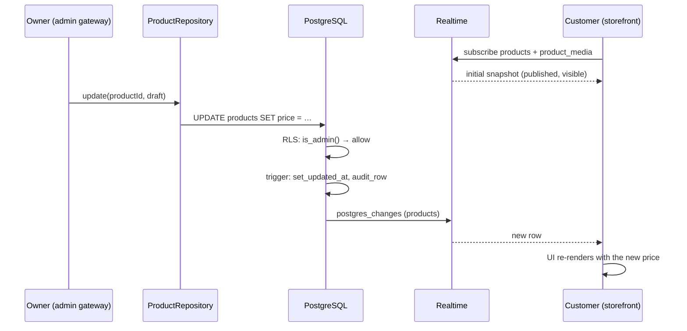
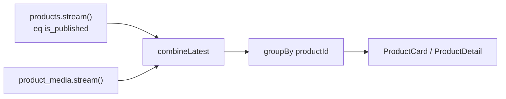
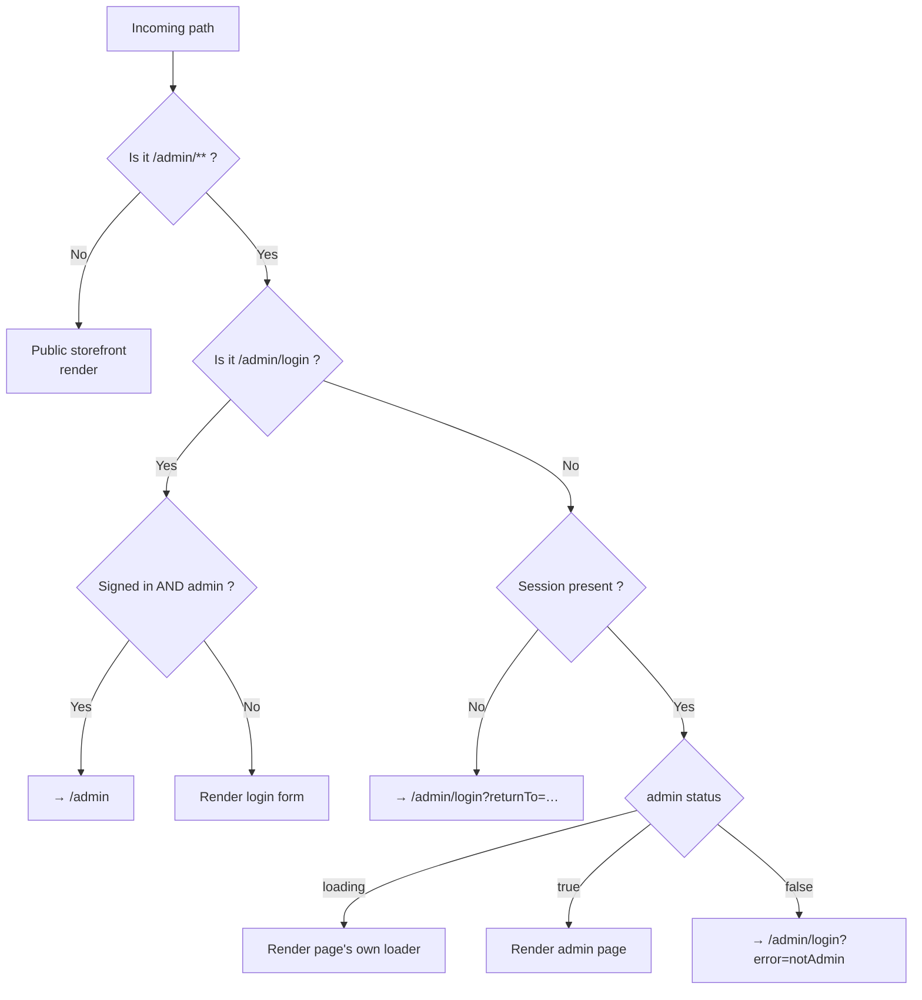
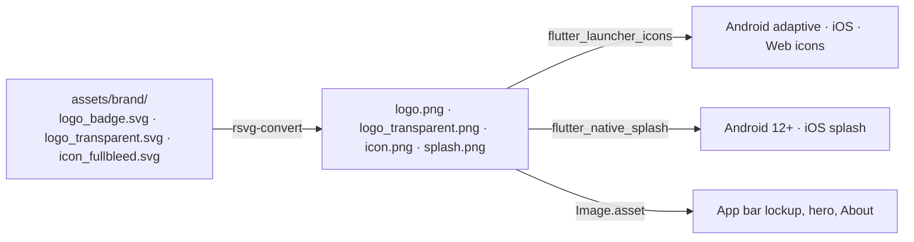

# ASM — Architecture

> Amu Sharif Arabiyan Majlis (`አሙ ሸሪፍ አረቢያን መጅሊስ` / `المجلس العربي عمو شريف`)
>
> One Flutter codebase, two wired-together experiences: a public luxury
> storefront and an owner-only admin gateway.

---

## 1. System context



**Only the public anon (publishable) key ever ships in the app.** The
service-role key lives solely inside the Edge Function's environment. Every
authorisation decision is enforced by PostgreSQL row level security, so a
tampered client gains nothing.

---

## 2. Layer architecture

Feature-first clean architecture. Each feature owns its three layers; nothing
in `domain/` knows that Supabase exists.



| Layer | May depend on | Must never depend on |
| --- | --- | --- |
| `presentation` | `domain`, `core` | `data` internals (only via providers) |
| `domain` | `core` | Flutter, Supabase, `data` |
| `data` | `domain`, `core` | `presentation` |

Errors cross every boundary as the sealed `AppFailure` hierarchy
(`lib/core/errors/app_failure.dart`). `ErrorMapper.guard()` wraps every
datasource call, so no `PostgrestException` or `SocketException` ever escapes
the data layer.

---

## 3. Critical wiring — one catalogue, two surfaces

Both experiences resolve the **same** repositories and the **same** providers.
The admin writes through the admin repository; the storefront reads through
RLS-protected public policies. Because reads are Realtime subscriptions, an
admin edit appears on every customer device without a refresh.



The storefront joins two independent streams — `products` and
`product_media` — in memory (`combineLatest` in `lib/core/utils/stream_utils.dart`)
so a newly uploaded photo appears without re-querying the product row.



---

## 4. The single router decides the surface

One `GoRouter` serves both surfaces. Every path runs through one pure function,
so the two experiences can never disagree about who may go where.



The decision lives in `resolveAdminRedirect()` (`lib/core/router/guards.dart`)
and is covered by nine unit tests in `test/unit/router_guards_test.dart`.

---

## 5. Directory map

```
lib/
  main.dart                 entry point
  bootstrap.dart            config validation → Supabase → preferences → Sentry → runApp
  app.dart                  MaterialApp.router (theme, locale, RTL)
  core/
    config/                 flavors, env (--dart-define), AppConfig
    theme/                  brand_colors, gradients, typography, app_theme
    router/                 routes, guards, app_router
    errors/                 AppFailure (sealed), ErrorMapper, localizer
    network/                Supabase client, connectivity, storage URLs
    utils/                  formatters, validators, launcher, stream utils
    widgets/                brand_logo, app_scaffold, gradient_button,
                            gold_divider, shimmer_card, empty_state, error_state
    l10n/generated/         AppLocalizations (en · am · ar)
  features/
    auth/                   domain · data · presentation
    catalog/                entities, drafts, repos, datasource, providers
    storefront/             home, category, product detail, search, 404
    admin/                  login, dashboard, change password, section shells
    contacts/               contact links + launcher rules
    settings/               site settings + local preferences
  l10n/                     app_en.arb · app_am.arb · app_ar.arb
supabase/
  migrations/               schema · views/RPCs · RLS · storage
  seed.sql                  categories, demo products, contact links
  functions/inquiry/        IP-rate-limited lead endpoint
  config.toml
tests/rls/                  local Supabase shim + RLS acceptance suite
scripts/                    run_rls_tests.sh · create_admin.sh
```

---

## 6. State management

Riverpod with code generation (`@riverpod`), `AsyncNotifier` for anything with
a lifecycle. **No business logic uses `setState`.**

| Concern | Provider |
| --- | --- |
| Supabase client | `supabaseClientProvider` (keep-alive, overridden in tests) |
| Auth session | `currentSessionProvider`, `currentUserProvider` |
| Admin verdict | `adminStatusProvider` (`AsyncNotifier<bool>`) |
| Catalogue reads | `storefrontProductsProvider`, `productDetailProvider` |
| Contact channels | `visibleContactLinksProvider`, `orderChannelsProvider` |
| Branding | `siteSettingsProvider` |
| Language / theme | `appPreferencesProvider` (persisted) |

Repositories are exposed as keep-alive providers and overridden with fakes in
tests, so no widget ever reaches the network.

---

## 7. Branding pipeline



Palette and type scale are single-sourced in `lib/core/theme/` so the gradient,
gold hairline and serif wordmark cannot drift between screens.
