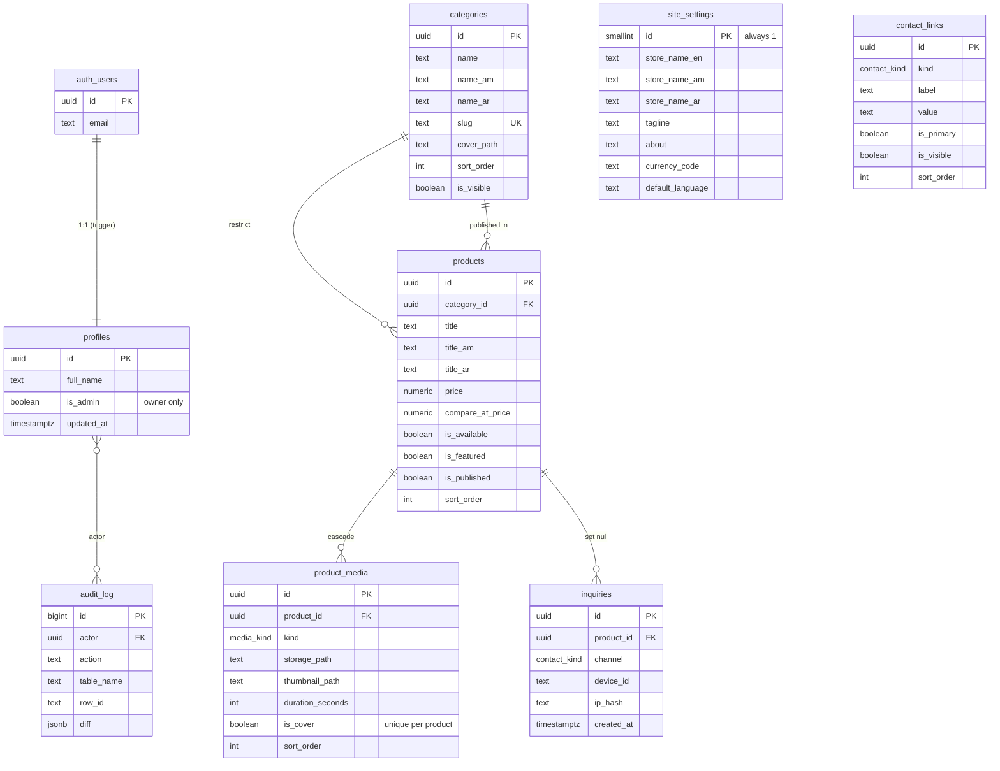

# ASM — Database

PostgreSQL 16 via Supabase. Schema, policies and buckets are all declared in
`supabase/migrations/`, so they travel with the code instead of living in
dashboard state.

---

## 1. Entity relationships



Enums: `media_kind` = `image | video`;
`contact_kind` = `whatsapp | telegram | phone | email | instagram | facebook |
tiktok | youtube | website | location | other`.

---

## 2. Migrations

| File | Contents |
| --- | --- |
| `20260101000000_extensions_and_helpers.sql` | `pgcrypto`, `pg_trgm`, `set_updated_at()` |
| `20260101000100_core_schema.sql` | 8 tables, 2 enums, indexes, `is_admin()`, `handle_new_user()`, `guard_profiles_is_admin()`, `audit_row()` + all triggers |
| `20260101000200_views_and_rpc.sql` | `v_products_public`, `v_categories_with_counts`, `search_products()`, `reorder_rows()`, `guard_inquiry_rate()` |
| `20260101000300_rls_policies.sql` | RLS on every table + the full policy set + grants |
| `20260101000400_storage_buckets.sql` | `product-media` and `brand` buckets + object policies |
| `20260101000500_realtime_publication.sql` | adds every streamed table to the `supabase_realtime` publication |
| `20260101000600_text_overrides.sql` | `text_overrides` (owner-authored wording) + `site_settings.store_name_om` + Oromo in the language check |

Migrations are idempotent — `create table if not exists`, `create or replace
function` / view, `drop trigger if exists` before every `create trigger`, and
`drop policy if exists` before every `create policy` — so re-applying the whole
set to a database that already holds it is a no-op instead of an error.
`.github/workflows/supabase-db-push.yml` applies and then re-applies the set to
a throwaway database, so the claim is enforced rather than asserted.

---

## 3. Authorisation model

`profiles.is_admin` is the **only** source of truth. It is never read from
client-editable metadata.

Three independent layers protect it:

1. **Grant layer** — `anon` holds no `UPDATE` on `profiles` at all.
2. **Policy layer** — `profiles_update_own` pins the row with
   `using (id = auth.uid()) with check (id = auth.uid())`.
3. **Trigger layer** — `guard_profiles_is_admin()` raises `42501` when
   `current_user` is `anon` or `authenticated` and `is_admin` changed. Only a
   direct SQL session as the project owner can flip the flag.

### Policy matrix

| Table | anon | authenticated (non-admin) | admin |
| --- | --- | --- | --- |
| `profiles` | — | SELECT own, UPDATE own | same |
| `site_settings` | SELECT | SELECT | SELECT, INSERT, UPDATE |
| `categories` | SELECT `is_visible` | SELECT `is_visible` | all rows, full CRUD |
| `products` | SELECT `is_published` + visible category | same | all rows, full CRUD |
| `product_media` | SELECT when parent publicly visible | same | all rows, full CRUD |
| `contact_links` | SELECT `is_visible` | SELECT `is_visible` | all rows, full CRUD |
| `inquiries` | INSERT only | INSERT only | SELECT, DELETE |
| `text_overrides` | SELECT | SELECT | SELECT, INSERT, UPDATE, DELETE |
| `audit_log` | — | — | SELECT |
| `storage.objects` | SELECT public buckets | SELECT public buckets | SELECT + write |

RLS is enabled on every table and **not forced** on the table owner, which is
what lets the `SECURITY DEFINER` helpers work. Every helper that therefore
bypasses RLS carries its own authorisation check:

| Function | Security | Why |
| --- | --- | --- |
| `is_admin()` | DEFINER | must read `profiles` from inside a policy on `profiles` |
| `handle_new_user()` | DEFINER | only path that inserts into `profiles` |
| `audit_row()` | DEFINER | audit write must never fail an admin write |
| `reorder_rows()` | DEFINER | dynamic SQL; explicitly checks `is_admin()` |
| `guard_inquiry_rate()` | DEFINER | must count rows anon cannot read |
| `search_products()` | INVOKER | storefront search, so RLS still applies |

---

## 4. RPC reference

### `search_products(q text, p_limit int default 40) → setof products`

Trigram (`%`) plus substring matching across `title`, `title_am`, `title_ar`
and `description`, ranked by `similarity()`. Backed by three GIN
`gin_trgm_ops` indexes. Filters to published products in visible categories, so
it is safe for anonymous callers.

### `reorder_rows(p_table text, p_ids uuid[]) → void`

Persists a whole manual ordering in one transaction. Rejects any table outside
`categories | products | product_media | contact_links` with `22023`, and any
non-admin caller with `42501`.

### `guard_inquiry_rate()` (trigger)

Caps one `device_id` at 10 inquiries per 10 minutes, raising `P0001`. Runs
before insert, so the cap holds even without the Edge Function.

---

## 5. Storage

| Bucket | Read | Write | Path | Limits |
| --- | --- | --- | --- | --- |
| `product-media` | public | admin only | `products/{product_id}/{uuid}.{ext}` | jpeg/png/webp ≤ 5 MB · mp4 ≤ 40 MB |
| `brand` | public | admin only | `logo/…`, `categories/…`, `splash/…` | jpeg/png/webp/svg ≤ 5 MB |

Bucket-level `file_size_limit` and `allowed_mime_types` provide the first line;
the object policies add the tighter 5 MB image cap and the path prefix check
that a bucket cannot express. Listing pages use Supabase image transforms
(`StorageUrls.productMediaThumb`) instead of downloading originals.

---

## 6. Audit trail

`audit_row()` fires `AFTER INSERT OR UPDATE OR DELETE` on `categories`,
`products`, `product_media`, `contact_links` and `site_settings`. Each row
records the actor (`auth.uid()`), the verb, the table, the row id and a JSONB
`old`/`new` diff. Only admins can read it; nothing can write it directly.

---

## 7. Running the RLS suite

The suite runs the **real** policies against a real PostgreSQL 16 instance. A
small shim (`tests/rls/00_supabase_shim.sql`) recreates the `anon`,
`authenticated` and `service_role` roles plus the `auth` and `storage` schemas,
so the migration files are applied exactly as they would be in production.

```bash
# Local PostgreSQL: point at any superuser connection
PGHOST=127.0.0.1 PGPORT=5433 PGUSER=postgres bash scripts/run_rls_tests.sh
```

CI runs the same script against a `postgres:16` service container.

### What the suite proves

| Group | Assertion |
| --- | --- |
| 1 | anon sees published products in visible categories only; not unpublished ones, not hidden categories, not their media, not hidden contact links |
| 2 | anon INSERT/UPDATE/DELETE denied on every table; data unchanged afterwards |
| 3 | anon may submit an inquiry but cannot read the lead log back |
| 3b | the rate limiter rejects the 11th submission from one device |
| 4 | a non-admin authenticated user cannot write anywhere, cannot read unpublished rows, can edit their own profile, and **cannot promote themselves** |
| 5 | the admin has full CRUD on every catalogue table, sees hidden rows, reads the audit log and lead log; audit triggers record the writes; `one_cover_per_product` rejects a second cover |
| 6 | `reorder_rows` works for an admin, rejects anon and non-admins, and refuses off-whitelist tables |
| 7 | `search_products` is RLS-filtered and asserted to be `SECURITY INVOKER` |
| 8 | the `security_invoker` views cannot leak unpublished rows |
| 9 | buckets exist and are public-read; anonymous and non-admin uploads are rejected; the 5 MB image cap and the `products/` prefix are enforced |
| 10 | every table in `public` has RLS enabled |

---

## 8. Creating the owner account

Public e-mail sign-up is disabled, so the owner account is created deliberately
and then promoted:

```bash
SUPABASE_URL='https://<ref>.supabase.co' \
SUPABASE_SERVICE_ROLE_KEY='<service-role-key>' \
SUPABASE_DB_URL='postgres://…' \
  ./scripts/create_admin.sh owner@example.com 'Strong-Passphrase-1'
```

The user is created with the Auth Admin API, because GoTrue needs rows in both
`auth.users` and `auth.identities` for password sign-in — a hand-written
`auth.users` insert produces an account that cannot log in (D-023). The
promotion itself is plain owner-run SQL.

Or, if the user already exists (created in the dashboard, for example):

```bash
SUPABASE_DB_URL='postgres://…' ./scripts/create_admin.sh --promote-only owner@example.com
```

Equivalently, by hand:

```sql
update public.profiles set is_admin = true where id = '<uid>';
```

New users are **never** admins: `profiles.is_admin` defaults to `false` and
`handle_new_user()` never sets it.
